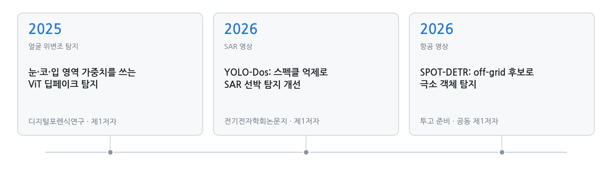
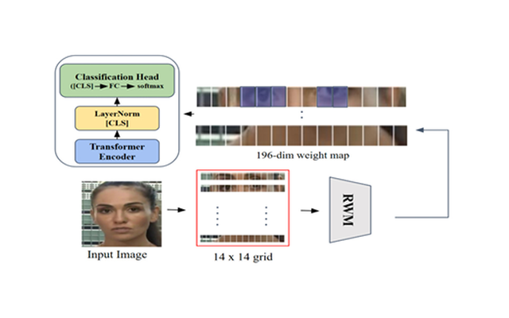

  
  
  
  
  

<a href="README_EN.md">English</a> · <b>한국어</b>

안녕하세요 👋 국립한밭대학교 컴퓨터공학과 엄기원입니다. 2024년 2월부터 장한얼 교수님 지도 아래 **AIM Lab**에서 학부연구생으로 연구하고 있습니다.

**컴퓨터 비전**, 그중에서도 광학·항공·SAR **위성 영상의 객체 탐지**를 주로 연구합니다. 검출기가 어떤 영상에서 왜 틀리는지 파고들어 바로 그 부분을 고치는 걸 좋아합니다.

연구 인턴, 대학원 진학, AI 연구 엔지니어 자리에 관심이 많습니다. 편하게 연락 주세요!

  
   
  
  

## 📢 소식

- **[2026.10]** SPOT-DETR 원고를 마무리했습니다. 곧 투고합니다!
- **[2026.10]** 2026 국립공원 위성 모니터링 AI 챌린지(해안 쓰레기 탐지)에서 **138팀 중 6위**를 했습니다.
- **[2026.09]** **LG Aimers 9기 결선**(3,393명 중 96명)에 올라 결선 33팀 중 18위를 했습니다. 온라인 예선은 1,090팀 중 29위였습니다.
- **[2026.03]** YOLO-Dos가 전기전자학회논문지에 실렸습니다.
- **[2025]** ViT 딥페이크 탐지 논문이 디지털포렌식연구에 실렸습니다.
- **[2024.02]** AIM Lab에 합류했습니다.

## 🔭 연구 분야

- **위성·항공 영상 객체 탐지**: 작고 빽빽한 객체(SPOT-DETR), 스펙클이 심한 SAR 영상(YOLO-Dos)
- **위성 영상 분석**: 구름 분할, 해안 쓰레기 탐지
- **영상 포렌식**: Vision Transformer 기반 딥페이크 탐지

<picture>
  <source media="(prefers-color-scheme: dark)" srcset="assets/research-line-ko-dark.png">
  
</picture>

## 📚 논문

† 공동 제1저자

<table>
<tr>
<td width="30%" valign="top"></td>
<td valign="top">
<b>YOLO-Dos: 스펙클 억제 모듈을 통한 YOLO 기반 SAR 객체 탐지 성능 개선</b> 
<b>엄기원</b>, 김은경, 장한얼 
<i>전기전자학회논문지</i>, 30(1), 171–181, 2026 · KCI 등재 
<a href="https://doi.org/10.7471/ikeee.2026.30.1.171">DOI</a> / <a href="https://www.kci.go.kr/kciportal/ci/sereArticleSearch/ciSereArtiView.kci?sereArticleSearchBean.artiId=ART003322680">KCI</a> 
HRSID에서 YOLOv8보다 mAP@50:95 +5.75%p
</td>
</tr>
<tr>
<td width="30%" valign="top"></td>
<td valign="top">
<b>눈·코·입 영역 강조 가중치를 활용한 ViT 기반 딥페이크 탐지 기법 연구</b> 
<b>엄기원</b>, 김동수, 오태우, 장한얼 
<i>디지털포렌식연구</i>, 19(4), 116–131, 2025 · KCI 등재 
<a href="https://doi.org/10.22798/KDFS.2025.19.4.116">DOI</a> / <a href="https://www.kci.go.kr/kciportal/ci/sereArticleSearch/ciSereArtiView.kci?sereArticleSearchBean.artiId=ART003243484">KCI</a> 
FaceForensics++에서 ViT 대비 ACER 7.94% 개선
</td>
</tr>
<tr>
<td width="30%" valign="top"></td>
<td valign="top">
<b>SPOT-DETR: Tiny object detection in aerial images using high-resolution feature refinement and off-grid candidate memory</b> 
<b>엄기원</b>†, 박천음†, 김은경, 장한얼 
<i>투고 준비 중</i>, 2026 
<a href="SPOT-DETR.md">프로젝트 페이지</a> / <a href="paper/SPOT_DETR_manuscript_20261022.pdf">원고</a> 
같은 조건으로 다시 학습한 비교 모델 중 AI-TOD 37.6 AP, AI-TOD-v2 33.3 AP로 최고
</td>
</tr>
</table>

<!--
학술대회 논문 (정보 받으면 추가)
- 저자. "제목." 학술대회명, 연도.
-->

## 🚀 프로젝트

**SPOT-DETR 웹 데모** · 캡스톤디자인(졸업작품), 2026

위성·항공 영상을 올리면 SPOT-DETR과 기준 모델(SMWG-DETR)의 탐지 결과를 나란히 보여 줍니다. 큰 영상은 원래 해상도 그대로 타일로 나눠 처리하고, 점수 임계값과 클래스 필터는 다시 돌리지 않아도 바로 반영됩니다. 위 주차장 장면에서 임계값 0.5 기준으로 SPOT-DETR은 차량 203대를, 기준 모델은 146대를 찾았습니다.

- **AI 기반 무허가 축사 탐지** · 한국수자원공사 협업, 2026 – 진행 중 · 항공 영상에서 축사를 탐지하는 모델 개발
- **위성 영상 구름 분할** · 팀장, 2025 · 두꺼운 구름·얇은 구름·그림자 분할, 교과 Kaggle 챌린지 **2위**(0.8555)
- **얼굴 위조 판별** · 팀장, 2025 · 실제 얼굴과 위조 얼굴을 정확도 98.33%로 구분
- **얼굴 인식 스마트 도어락** · 팀장, 2024 · Raspberry Pi 4, OpenCV, SQLite, MQTT

## 🏆 수상·대회

| 결과 | 대회 | 연도 |
|---|---|:---:|
| **결선 진출**(3,393명 중 96명) · 결선 **18위 / 33팀** | **LG Aimers 9기 해커톤** · 투구 제구 성공 확률 예측 · [온라인 예선](https://dacon.io/competitions/official/236743/overview/description) 1,090팀 중 29위(상위 3%) · [오프라인 결선](https://dacon.io/competitions/official/236767/overview/description) | 2026 |
| **6위 / 138팀**(상위 5%) | [2026 국립공원 위성 모니터링 AI 챌린지](https://aifactory.space/ko/competitions/9307) · 주제 4: 해안 쓰레기 탐지 및 규모 추정 | 2026 |
| **16위 / 271팀**(상위 6%) | [2025 SW중심대학 디지털 경진대회](https://dacon.io/competitions/official/236473/overview/description) · AI부문 | 2025 |
| **85위 / 985팀**(상위 9%) | [제3회 풍력발전량 예측 AI 경진대회](https://dacon.io/competitions/official/236727/overview/description) (BARAM 2026) | 2026 |
| **28위 / 219팀**(상위 13%) | [SW중심대학 디지털 경진대회](https://dacon.io/competitions/official/236253/overview/description) · SW와 생성 AI의 만남, AI부문 | 2024 |
| **2위** | [위성 영상 구름 분할 Kaggle 챌린지](https://www.kaggle.com/competitions/clouds-segmentation-2025/overview) · 국립한밭대학교 AI 교과 | 2025 |

## 🎓 경력·학력

- **AIM Lab, 국립한밭대학교** · 학부연구생, 지도교수 장한얼 · 2024.02 – 현재
  - 참여 과제: 국방기술진흥연구소 우주계층 지능통신망 특화연구실 5세부 *퍼즐형 초광역 공간 위성영상 지능형 처리 연구*(경희대학교·국립한밭대학교). SPOT-DETR은 이 과제와 연계한 연구입니다.
- **국립한밭대학교** · 컴퓨터공학과 학사과정 · 2023.03 – 현재

## ⚡ 기술

**언어** 
  

**딥러닝·비전** 
      

**실험 환경** 
   

<!--
생기면 추가: 발표·포스터 / 조교 / 리뷰어 / 공개 코드
-->

---

2026학년도 국립한밭대학교 컴퓨터공학과 포트폴리오경진대회 출품작
