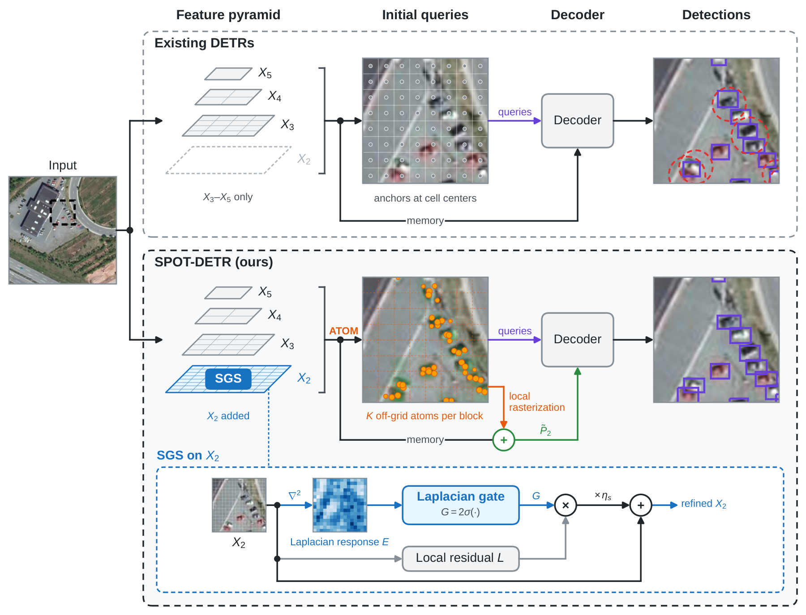
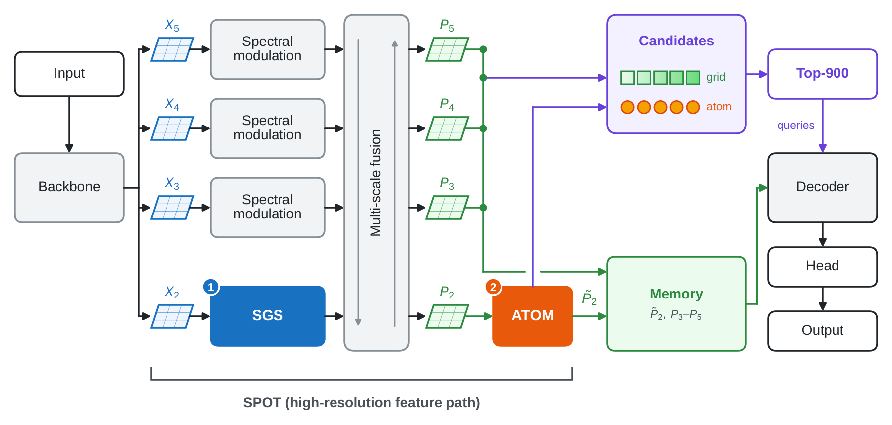
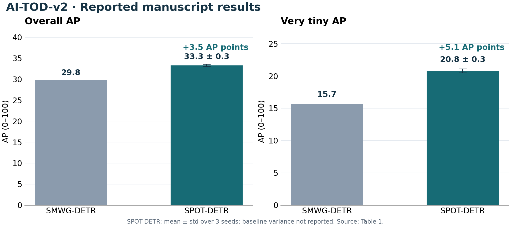
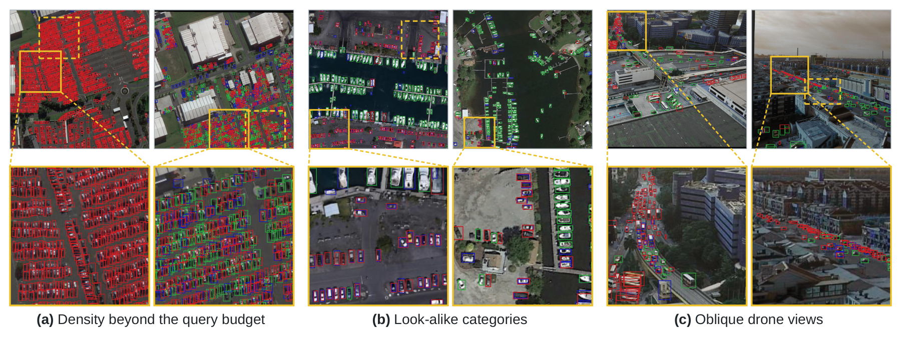

# SPOT-DETR

### 작은 객체의 공간 단서를 지키고, 격자를 벗어난 초기 후보로 탐지하다

**2026학년도 국립한밭대학교 컴퓨터공학과 포트폴리오경진대회 · 엄기원**

항공 영상에서 수 픽셀 크기의 차량·사람을 놓치는 원인을 분석하고, 고해상도 특징과 연속 좌표 후보를 결합한 객체 탐지 모델을 설계·구현했습니다. 모델을 만드는 데서 그치지 않고, 비교 실험·구성요소 분석·실패 사례를 통해 **어디에서 성능이 좋아지고 어떤 비용이 생기는지** 확인했습니다.

| AI-TOD-v2 전체 탐지 AP | 매우 작은 객체 AP<sub>vt</sub> | 매우 작은 객체 초기 후보 재현율 |
|:---:|:---:|:---:|
| **33.3 ± 0.3** | **20.8 ± 0.3** | **67.1%** |
| SMWG-DETR 대비 **+3.5 AP 포인트** | SMWG-DETR 대비 **+5.1 AP 포인트** | 기준 모델 38.5% → **+28.6%p** |

AP는 0–100 척도이며 정확도(accuracy)와 다른 지표입니다. 첫 두 값은 3개 시드의 평균 ± 표준편차, 후보 재현율은 시드 42 분석 모델의 상위 900개 초기 후보를 IoU ≥ 0.5로 평가한 값입니다. 근거: 원고 표 1·5.

**연구 상태: 투고 전 원고 · 기준일: 2026.10.22**

[연구 원고 PDF](paper/SPOT_DETR_manuscript_20261022.pdf) · [설계 상세](docs/design.md) · [전체 실험표](docs/experiments.md) · [구현·재현 범위](docs/implementation.md) · [결과 CSV](results/README.md)



*원고 그림 1. 같은 영상의 확대 영역에서 초기 후보와 탐지 결과를 비교했습니다. 선택한 장면의 예시이며 전체 성능은 실험표로 평가합니다. 정성 그림의 점수 임계값은 모델별로 다릅니다.*

## 1. 저는 이런 문제를 연구합니다

저는 **작고 희미한 대상도 놓치지 않는 컴퓨터 비전**에 관심이 있습니다. 항공·위성 영상에서는 영상 전체를 이해하는 능력과 몇 픽셀의 차이를 보존하는 능력이 함께 필요합니다. 이 연구에서는 기존 모델의 오탐·누락을 관찰하고, 이를 특징 해상도와 초기 후보의 위치라는 두 가지 설계 문제로 구체화했습니다.

| 항목 | 내용 |
|---|---|
| 이름 / 소속 | 엄기원 · 국립한밭대학교 컴퓨터공학과 |
| 학번 | 20231203 |
| 관심 분야 | 컴퓨터 비전, 항공·위성 영상 이해, 극소 객체 탐지 |
| 대표 연구 | SPOT-DETR: 고해상도 특징 정제와 off-grid 후보 메모리를 이용한 항공 영상 극소 객체 탐지 |
| 직접 수행한 업무 | 연구 문제 정의, 방법 설계, 소프트웨어 구현, 데이터 구성, 비교·분석 실험, 시각화, 원고 작성 |
| 원고의 저자 표기 | 엄기원·박천음 공동 제1저자, 김은경·장한얼 공동 교신저자 |
| 연락 | [eomkiwon1528@gmail.com](mailto:eomkiwon1528@gmail.com) · [GitHub](https://github.com/EomOrigin) |

## 2. 프로젝트 배경 — 몇 픽셀의 차이가 누락으로 이어집니다

교통량 분석·해양 감시·재난 대응에서는 넓은 지역을 촬영한 영상에서 작은 객체의 수와 위치를 파악해야 합니다. 하지만 극소 객체는 윤곽과 질감 정보가 적어 배경이나 인접 객체와 쉽게 섞입니다.

연구의 출발점은 두 가지였습니다.

1. **다운샘플링으로 사라지는 세부 정보.** stride 8 특징에서 한 변 8픽셀인 객체는 약 한 셀 크기입니다. 경계와 중심 단서가 약해지고, 가까운 객체가 같은 응답으로 합쳐집니다.
2. **격자 셀 중심에서 출발하는 초기 후보.** 8×8픽셀 상자의 중심이 가로·세로로 각각 2픽셀 어긋나면 IoU가 약 0.39로 떨어집니다. 작은 위치 오차가 IoU 0.5 기준의 탐지 실패로 이어질 수 있습니다.

따라서 **객체 단서가 남아 있는 특징을 제공하면서, 그 특징에서 더 나은 초기 위치를 만드는 것**을 하나의 과제로 설정했습니다. 기준 모델은 SMWG-DETR이며, 기존의 스펙트럼 변조·웨이블릿 융합·잡음 제거 학습을 기반으로 확장했습니다.

## 3. 설계 — 하나의 고해상도 경로에 SGS와 ATOM을 연결했습니다

SPOT은 **Spatially-gated Path with Off-grid Tokens**의 약자입니다. 백본의 stride 4 특징 X₂를 시작으로 SGS → 다중 스케일 융합 → ATOM을 연결한 경로이며, 이를 적용한 전체 탐지기가 SPOT-DETR입니다.



| 설계 | 구현한 방식 | 해결하려는 문제 |
|---|---|---|
| 고해상도 특징 경로 | stride 4의 X₂를 특징 피라미드에 추가 | 다운샘플링으로 약해지는 경계·중심 단서 |
| SGS | 라플라시안 응답으로 공간 게이트를 만들고 국소 잔차에 적용 | 고해상도 특징의 국소 정보 정제 |
| ATOM | P₂의 2×2 블록마다 연속 중심 좌표를 갖는 atom 2개 생성 | 셀 중심에 고정된 초기 후보의 위치 제약 |
| 후보 선택·메모리 | atom과 P₃–P₅ 격자 후보 중 900개 선택, 국소 래스터 잔차로 P₂ 보완 | 초기 쿼리와 디코더 메모리에 같은 객체 표현 활용 |

800×800 입력에서 P₂는 200×200입니다. ATOM은 10,000개 블록에서 20,000개의 atom을 만들고, 최종적으로 선택된 900개의 초기 쿼리를 6층 디코더에 전달합니다. 추론은 NMS 없이 수행합니다. [모듈별 설계와 텐서 크기 →](docs/design.md)

## 4. 본인 기여 — 가설을 구현하고 분석으로 다시 점검했습니다

| 단계 | 직접 수행한 내용 | 산출물·확인 근거 |
|---|---|---|
| 문제 정의 | 극소 객체의 특징 소실과 격자 초기화 오차를 연구 문제로 정리 | 원고 1절, 그림 1, 초기 후보 분석 |
| 설계·구현 | X₂ 경로 확장, SGS, ATOM 및 후보 선택·래스터화 경로 구현 | 원고 3절, 그림 2–4, 구현 구조 정리 |
| 실험 구성 | AI-TOD·AI-TOD-v2 학습·평가 구성, 기준·비교 모델 실험, 3개 시드 반복 | 원고 4.1–4.2절, 표 1–3 |
| 원인 분석 | 구성요소 실험, 후보 재현율·중심 오차·특징 맵 분석 | 원고 4.3절, 표 4–5, 그림 7 |
| 결과 전달 | 성능·효율·실패 사례를 표와 그림으로 정리하고 원고 작성 | 원고 표 6, 그림 8 및 연구 원고 |

특히 분석 결과에 맞춰 설명의 강도를 조정했습니다. SGS의 학습된 게이트는 전경·배경에서 모두 상한에 가까웠고, 객체와 배경의 활성도 대비도 기준 모델과 비슷했습니다. 이에 따라 결과를 **강한 배경 억제**로 설명하기보다 **고해상도에서 인접 객체의 응답을 분리한 효과**로 해석했습니다. [개발 과정과 배운 점 →](docs/development.md)

## 5. 실험 결과 — 성능, 반복성, 개선 원인을 함께 확인했습니다

### 실험 조건

AI-TOD와 AI-TOD-v2의 공식 train+validation 14,018장으로 학습하고 test 14,018장으로 평가했습니다. AI-TOD-v2는 AI-TOD와 **같은 영상의 주석을 수정한 데이터셋**입니다. ResNet-50, 800×800 입력, 배치 4, 40에포크, AdamW, 데이터 증강 없음, EMA 평가를 사용했습니다. 원고는 비교 모델도 동일한 분할·40에포크 조건으로 다시 학습했다고 보고합니다.

### AI-TOD-v2: 전체 성능과 크기별 성능

| 모델 | AP | AP<sub>vt</sub> | AP<sub>t</sub> | AP<sub>s</sub> |
|---|---:|---:|---:|---:|
| RT-DETR | 29.6 | 16.1 | 30.2 | 32.9 |
| DQ-DETR | 30.2 | 15.6 | 30.4 | 35.7 |
| SMWG-DETR · 기준 모델 | 29.8 | 15.7 | 30.5 | 33.9 |
| **SPOT-DETR** | **33.3 ± 0.3** | **20.8 ± 0.3** | **34.5 ± 0.7** | **36.1 ± 0.2** |

*원고 표 1. 0–100 AP 척도. SPOT-DETR만 3개 시드 평균 ± 표준편차이며, 비교 모델의 시드 분산은 보고되지 않았습니다. vt/t/s는 객체 면적의 제곱근이 각각 2–8/8–16/16–32픽셀인 구간입니다.*



SPOT-DETR은 **원고의 공통 프로토콜로 비교한 모델 중** 가장 높은 전체 AP를 기록했습니다. AI-TOD에서도 AP **37.6 ± 0.1**, AP<sub>vt</sub> **23.3 ± 0.4**로, 기준 모델보다 각각 **5.5·5.7 AP 포인트** 높았습니다. 두 주석 버전에서 개선을 확인했으며, 서로 다른 영상 도메인에 대한 일반화는 추가 검증이 필요합니다.

### 구성요소와 초기 후보 분석

| 구성 | AP | AP<sub>vt</sub> |
|---|---:|---:|
| 기준 모델 | 29.8 | 15.7 |
| +SGS · X₂ 경로 포함 | 33.2 | 20.7 |
| +ATOM · X₂ 경로 포함 | **33.8** | 20.0 |
| +SGS +ATOM · 최종 구성 | 33.7 | **21.2** |

*원고 표 4. 단일 분석 모델의 결과이므로, 위 3개 시드 평균 33.3과 구분합니다. 추가 구성은 모두 X₂ 경로를 포함합니다.*

최종 구성의 전체 AP는 +ATOM보다 0.1포인트 낮지만, 연구의 핵심인 매우 작은 객체 AP<sub>vt</sub>는 1.2포인트 높았습니다. 따라서 모든 지표에서 결합 효과가 최고라고 주장하지 않고, **극소 객체 성능을 우선한 선택**으로 설명합니다.

상위 900개 초기 후보의 매우 작은 객체 재현율은 기준 모델 **38.5% → X₂ 추가 62.8% → SPOT-DETR 67.1%**였습니다. IoU ≥ 0.25로 대응된 후보의 중심 오차 중앙값은 **1.49 → 1.13 → 1.00픽셀**이었습니다. 고해상도 경로가 큰 개선의 공통 기반이며, ATOM의 추가 효과도 구분해서 해석했습니다. [전체 비교표·범주별 결과·분석 조건 →](docs/experiments.md)

## 6. 한계 — 정확도를 높이는 데 드는 비용도 확인했습니다

| 항목 | SMWG-DETR | SPOT-DETR | 해석 |
|---|---:|---:|---|
| 파라미터 | 50.48M | 58.28M | +7.80M |
| 연산량 | 147.3 GFLOPs | 382.4 GFLOPs | 고해상도 처리 비용 증가 |
| 추론 속도 | 18.31 FPS | 9.14 FPS | 처리 속도 약 절반 |
| 지연 시간 | 54.6 ms | 109.4 ms | 정확도 우선 분석 작업에 적합 |

*원고 표 6의 보고값입니다. 입력은 800×800이며 측정 조건의 상세 확인 범위는 [효율성 표 설명](docs/experiments.md#효율성과-측정-범위)에 기록했습니다.*

실패는 초밀집 장면, 유사 범주가 섞인 항만, 비스듬한 촬영 장면에서 나타났습니다. 특히 900개의 고정 쿼리로는 한 영상의 900개를 넘는 객체를 모두 검출할 수 없습니다. 실시간 처리가 필요한 응용에는 현재의 속도가 제약입니다.



*원고 그림 8. 초록/파랑/빨강은 각각 TP/FP/FN입니다. 성공 장면과 함께 실패가 발생하는 조건을 분석했습니다.*

## 7. 배운 점과 다음 연구

이번 연구를 통해 **성능 향상을 설계 의도와 동일하게 취급하지 않는 것**을 배웠습니다. X₂ 경로·SGS·ATOM이 함께 변하는 실험에서는 효과를 한 모듈의 공으로만 돌릴 수 없고, 특징 맵·후보·최종 AP를 각각 확인해야 했습니다. 평균 성능과 단일 시드 분석, 정량 지표와 선택한 정성 장면도 구분해 전달했습니다.

다음 단계는 ① 전경 영역에 고해상도 연산을 집중해 계산량 줄이기, ② 밀도에 따른 쿼리 수 조절로 초밀집 장면 대응, ③ 원근·스케일 증강과 다른 촬영 조건에서 검증하기입니다. 모두 **후속 연구 계획**이며, 현재 성과와 구분합니다.

## 8. 산출물과 확인 방법

| 자료 | 내용 |
|---|---|
| [연구 원고](paper/SPOT_DETR_manuscript_20261022.pdf) | 2026.10.22 버전의 투고 전 원고 |
| [설계 상세](docs/design.md) | 문제와 모듈의 대응, 구조·텐서 크기, 기존 기술과 신규 설계 |
| [실험 상세](docs/experiments.md) | 전체·범주별 성능, ablation, 초기 후보, 효율 및 해석 범위 |
| [개발 과정](docs/development.md) | 직접 수행한 작업, 설계 선택, 분석에서 얻은 교훈 |
| [구현·재현 범위](docs/implementation.md) | 구현 환경, 모델 실행에 필요한 자료, 문서와 실험 코드의 범위 |
| [결과 CSV](results/README.md) | 원고 표 1–6을 옮긴 데이터 및 출처 설명 |
| [참고 자료](docs/references.md) | 데이터셋·기반 기술·관련 개인 프로젝트 |

이 저장소는 연구 포트폴리오와 결과 자료를 제공합니다. **모델 학습·추론 코드와 체크포인트는 포함하지 않습니다.** 아래 명령은 CSV에서 결과 차이를 계산하며, 모델을 다시 평가하지 않습니다.

```bash
python3 scripts/summarize_results.py
```

관련 활동: [2025년 딥페이크 탐지 연구 포트폴리오](https://github.com/EomOrigin/HBNU-SWUNIV_2025_eomkiwon) · [FedVLS 재현 프로젝트](https://github.com/EomOrigin/FedVLS_Reproducibility_project) · [개인 연구 소개](https://github.com/EomOrigin/Kiwonofficial)

---

**엄기원 · EomOrigin** · [GitHub](https://github.com/EomOrigin) · [메일](mailto:eomkiwon1528@gmail.com)
