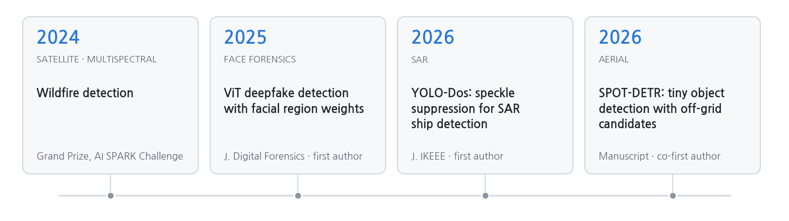

  
  
  
  
  

<b>English</b> · <a href="README.md">한국어</a>

Hi there 👋 I'm Ki-won, an undergrad in Computer Engineering at **Hanbat National University** and an undergraduate researcher in the **AIM Lab** (advised by Prof. Haneol Jang) since Feb 2024.

I work on **computer vision**, mostly **object detection in satellite imagery**: optical, aerial and SAR. I like figuring out why a detector fails on a certain kind of image and then fixing exactly that.

I'm open to **research internships**, **graduate programs** and **AI research engineer roles**. Feel free to reach out!

  
   
  
  

## 📢 News

- **[Oct 2026]** Finished the SPOT-DETR manuscript. Submitting soon!
- **[Oct 2026]** Placed **6th of 138 teams** in the 2026 National Park Satellite Monitoring AI Challenge (coastal debris detection).
- **[Sep 2026]** Made the **LG Aimers 9th cohort final** (96 of 3,393 participants) and finished 18th of 33 teams there. We were 29th of 1,090 teams in the online round.
- **[Mar 2026]** YOLO-Dos is out in the Journal of IKEEE.
- **[2025]** Our ViT deepfake detection paper is out in the Journal of Digital Forensics.
- **[Feb 2024]** Joined the AIM Lab.

## 🔭 What I work on

- **Object detection in satellite and aerial images**: tiny, densely packed objects (SPOT-DETR) and speckle-heavy SAR scenes (YOLO-Dos)
- **Satellite image analysis**: cloud segmentation, coastal debris detection
- **Image forensics**: deepfake detection with Vision Transformers

<picture>
  <source media="(prefers-color-scheme: dark)" srcset="assets/research-line-en-dark.png">
  
</picture>

## 📚 Publications

† equal contribution

<table>
<tr>
<td width="30%" valign="top"></td>
<td valign="top">
<b>YOLO-Dos: Improving YOLO-based SAR object detection performance via a speckle suppression module</b> 
<b>Ki-won Eom</b>, Eunkyung Kim, Haneol Jang 
<i>Journal of IKEEE</i>, 30(1):171–181, 2026 · KCI 
<a href="https://doi.org/10.7471/ikeee.2026.30.1.171">DOI</a> / <a href="https://www.kci.go.kr/kciportal/ci/sereArticleSearch/ciSereArtiView.kci?sereArticleSearchBean.artiId=ART003322680">KCI</a> 
+5.75 mAP@50:95 over YOLOv8 on HRSID
</td>
</tr>
<tr>
<td width="30%" valign="top"></td>
<td valign="top">
<b>ViT-based deepfake detection via regional emphasis weights on eyes, nose, and mouth</b> 
<b>Ki-won Eom</b>, Dong-Su Kim, Tae-Woo Oh, Haneol Jang 
<i>Journal of Digital Forensics</i>, 19(4):116–131, 2025 · KCI 
<a href="https://doi.org/10.22798/KDFS.2025.19.4.116">DOI</a> / <a href="https://www.kci.go.kr/kciportal/ci/sereArticleSearch/ciSereArtiView.kci?sereArticleSearchBean.artiId=ART003243484">KCI</a> 
ACER improved by 7.94% over plain ViT on FaceForensics++
</td>
</tr>
<tr>
<td width="30%" valign="top"></td>
<td valign="top">
<b>SPOT-DETR: Tiny object detection in aerial images using high-resolution feature refinement and off-grid candidate memory</b> 
<b>Ki-won Eom</b>†, Cheoneum Park†, Eunkyung Kim, Haneol Jang 
<i>Manuscript in preparation</i>, 2026 
<a href="SPOT-DETR_EN.md">project page</a> / <a href="paper/SPOT_DETR_manuscript_20261022.pdf">manuscript</a> 
37.6 AP on AI-TOD, 33.3 AP on AI-TOD-v2, best among the detectors retrained under the same setting
</td>
</tr>
</table>

<!--
Conference papers (add when ready)
- Authors. "Title." Conference, Year.
-->

## 🚀 Projects

**SPOT-DETR web demo** · capstone design project, 2026

Upload a satellite or aerial image and see SPOT-DETR and the SMWG-DETR baseline side by side. Large images are tiled at native resolution, and the score threshold and class filters update the result without rerunning. On this parking scene SPOT-DETR finds 203 vehicles at a 0.5 threshold, the baseline 146.

- **AI-based detection of unpermitted livestock barns** · with K-water, 2026 – ongoing · developing a model that detects barns in aerial imagery
- **Cloud segmentation in satellite imagery** · team lead, 2025 · thick cloud, thin cloud and shadow masks; **2nd place** in a course Kaggle challenge (0.8555)
- **Face anti-spoofing** · team lead, 2025 · live vs. spoofed faces at 98.33% accuracy
- **Face-recognition smart door lock** · team lead, 2024 · Raspberry Pi 4, OpenCV, SQLite, MQTT

## 🏆 Honors & Competitions

| Result | Competition | Year |
|---|---|:---:|
| **Finalist** (96 of 3,393 participants) · **18th of 33 teams** in the final | **LG Aimers 9th cohort hackathon** · pitch control prediction · [online round](https://dacon.io/competitions/official/236743/overview/description) 29th of 1,090 teams (top 3%) · [final](https://dacon.io/competitions/official/236767/overview/description) | 2026 |
| **6th / 138** (top 5%) | [2026 National Park Satellite Monitoring AI Challenge](https://aifactory.space/ko/competitions/9307) · Track 4: coastal debris detection and size estimation | 2026 |
| **16th / 271** (top 6%) | [2025 SW-Centered University Digital Competition](https://dacon.io/competitions/official/236473/overview/description) · AI track | 2025 |
| **85th / 985** (top 9%) | [3rd Wind Power Generation Forecasting AI Competition](https://dacon.io/competitions/official/236727/overview/description) (BARAM 2026) | 2026 |
| **28th / 219** (top 13%) | [SW-Centered University Digital Competition](https://dacon.io/competitions/official/236253/overview/description) · SW meets generative AI, AI track | 2024 |
| **2nd** | [Cloud segmentation Kaggle challenge](https://www.kaggle.com/competitions/clouds-segmentation-2025/overview) · Hanbat National University AI course | 2025 |

## 🎓 Experience & Education

- **AIM Lab, Hanbat National University** · undergraduate researcher, advised by Prof. Haneol Jang · Feb 2024 – present
  - Research project: Space-layer Intelligent Communication Network Specialized Research Lab (KRIT), Sub-project 5: *intelligent processing of puzzle-type ultra-wide-area satellite imagery*, with Kyung Hee University. SPOT-DETR is linked to this project.
- **Hanbat National University** · B.S. in Computer Engineering · Mar 2023 – present

## ⚡ Skills

**Languages** 
  

**DL / CV** 
      

**Infra** 
   

<!--
Add when available: Talks & posters / Teaching / Reviewing / Open source
-->

---

Entry for the 2026 Portfolio Competition of the Department of Computer Engineering, Hanbat National University
