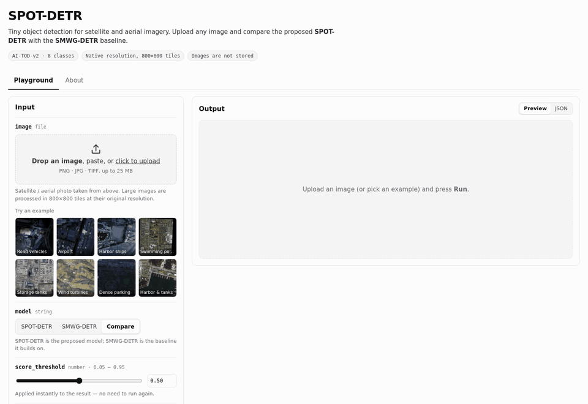

  
  
  
  

<a href="README.md">English</a> · <b>한국어</b>

**Hi!** 컴퓨터 비전 & 멀티모달 연구자 엄기원입니다.

## 📢 소식

- **[2026.10]** 항공 영상 극소 객체 탐지 논문, *Scientific Reports*(SCIE) 투고 및 심사 중
- **[2026.09]** **LG Aimers 9기 해커톤 결선 진출**(3,393명 중 96명) 및 결선 18위(33팀 중) 달성, 온라인 예선 29위(1,090팀 중, 상위 3%)
- **[2026.03]** YOLO-Dos, 한국전기전자학회 *전기전자학회논문지*(KCI) 게재
- **[2025.08]** ViT 딥페이크 탐지 논문, 한국디지털포렌식학회 *디지털포렌식연구*(KCI) 게재
- **[2024.02]** 인공지능멀티모달 연구실(AIM Lab) 합류

## 🔭 연구 분야

- **객체 탐지**: 대규모 위성·항공 영상 속 작고 밀집한 객체
- **위성 영상 처리**: 구름 분할, 해안 쓰레기 탐지
- **딥러닝·머신러닝**, 멀티모달 학습 포함

<picture>
  <source media="(prefers-color-scheme: dark)" srcset="assets/research-line-ko-dark.png">
  
</picture>

## 📚 논문

† 공동 제1저자

<table>
<tr>
<td width="30%" valign="top"></td>
<td valign="top">
<b>YOLO-Dos: 스펙클 억제 모듈을 통한 YOLO 기반 SAR 객체 탐지 성능 개선</b> 
<b>엄기원</b>, 김은경, 장한얼 
<i>전기전자학회논문지</i>, 30(1), 171–181, 2026 · KCI 등재 
<a href="https://doi.org/10.7471/ikeee.2026.30.1.171">DOI</a> / <a href="https://www.kci.go.kr/kciportal/ci/sereArticleSearch/ciSereArtiView.kci?sereArticleSearchBean.artiId=ART003322680">KCI</a> 
HRSID에서 YOLOv8보다 mAP@50:95 +5.75%p
</td>
</tr>
<tr>
<td width="30%" valign="top"></td>
<td valign="top">
<b>눈·코·입 영역 강조 가중치를 활용한 ViT 기반 딥페이크 탐지 기법 연구</b> 
<b>엄기원</b>, 김동수, 오태우, 장한얼 
<i>디지털포렌식연구</i>, 19(4), 116–131, 2025 · KCI 등재 
<a href="https://doi.org/10.22798/KDFS.2025.19.4.116">DOI</a> / <a href="https://www.kci.go.kr/kciportal/ci/sereArticleSearch/ciSereArtiView.kci?sereArticleSearchBean.artiId=ART003243484">KCI</a> 
FaceForensics++에서 ViT 대비 ACER 7.94% 개선
</td>
</tr>
</table>

**학술대회**

- **엄기원**, 장한얼. "FUSE-DETR: 고해상도 특징 보정을 통한 위성영상 내 초소형 객체 탐지 성능 향상." *한국해군과학기술학회 2026 하계학술대회*, 2026.07.
- **엄기원**, 장한얼. "DETR 기반 4-Level Feature Pyramid 확장을 통한 위성영상 내 초소형 객체 탐지 성능 향상." *대한전자공학회 2026 하계종합학술대회*, 2026.06.
- 김겸, **엄기원**, 표성민, 장한얼. "Density-Aware Query Score Adjustment for Tiny Object Detection." *KIBME2026*, 2026.06.
- 김겸, **엄기원**, 장한얼. "Improving Tiny Object Detection through High-Frequency Enhancement of High-Resolution Features." *KIBME2026*, 2026.11. 심사 중.
- **엄기원**, 김은경, 장한얼. "YOLO-Dos: 스펙클 억제 모듈을 통한 YOLO 기반 SAR 객체 탐지 성능 향상." *한국방송·미디어공학회 2025 동계학술대회*, 2025.12. [DBpia](https://www.dbpia.co.kr/journal/articleDetail?nodeId=NODE12571861)
- **엄기원**, 김동수, 장한얼. "ViT 기반 딥페이크 탐지를 위한 눈, 코, 입 영역 강조 기법 연구." *한국방송·미디어공학회 2025 하계학술대회*, 2025.06. [DBpia](https://www.dbpia.co.kr/journal/articleDetail?nodeId=NODE12288087)

**학술지 (심사 중)**

- **엄기원**†, 박천음†, 김은경, 장한얼. "Tiny Object Detection in Aerial Images." *Scientific Reports* (SCIE, IF 4.9, Top JCR 14.6%), 2026. 심사 중.
- 김겸, **엄기원**, 장한얼. "Improving Tiny Object Detection via High-Resolution Feature Refinement." *전기전자학회논문지*, 2026. 심사 중.

## 🚀 프로젝트

**위성 영상 극소 객체 탐지 웹 데모** · 캡스톤디자인(졸업작품, TOD 팀), 2026

위성·항공 영상 업로드 시 우리 모델과 기준 모델(SMWG-DETR)의 탐지 결과를 나란히 비교. 큰 영상은 원본 해상도 그대로 타일 분할 처리, 점수 임계값·클래스 필터는 재추론 없이 즉시 반영.

- **퍼즐형 초광역 공간 위성영상 지능형 처리 연구** · 국방기술진흥연구소 우주계층 지능통신망 특화연구실 5세부, 경희대학교 공동 · 2026 – 진행 중 · 데이터셋 분석, DETR 기반 극소 객체 탐지 네트워크 설계, 성능 평가.
- **AI 기반 무허가 축사 탐지** · 한국수자원공사 협업, 2026 – 진행 중 · K-water 시범 서비스용 축사 탐지 모델 개발

## 🏆 수상·대회

| 결과 | 대회 | 연도 |
|---|---|:---:|
| **상위 3%**(29위 / 1,090팀) · 결선 진출(3,393명 중 96명), 결선 18위 / 33팀 | **LG Aimers 9기 해커톤** · 투구 제구 성공 확률 예측 · [온라인 예선](https://dacon.io/competitions/official/236743/overview/description) · [오프라인 결선](https://dacon.io/competitions/official/236767/overview/description) | 2026 |
| **상위 5%**(6위 / 138팀) | [2026 국립공원 위성 모니터링 AI 챌린지](https://aifactory.space/ko/competitions/9307) · 주제 4: 해안 쓰레기 탐지 및 규모 추정 · [**코드**](https://github.com/EomOrigin/coastal-debris-segmentation) | 2026 |
| **상위 6%**(16위 / 271팀) | [2025 SW중심대학 디지털 경진대회](https://dacon.io/competitions/official/236473/overview/description) · AI부문: 생성형 AI 작성 글 판별 | 2025 |
| **상위 9%**(85위 / 985팀) | [제3회 풍력발전량 예측 AI 경진대회](https://dacon.io/competitions/official/236727/overview/description) (BARAM 2026) | 2026 |
| **상위 13%**(28위 / 219팀) | [SW중심대학 디지털 경진대회](https://dacon.io/competitions/official/236253/overview/description) · SW와 생성 AI의 만남, AI부문: 가짜 음성 탐지 | 2024 |
| **1위** | [위성 영상 구름 분할 Kaggle 챌린지](https://www.kaggle.com/competitions/clouds-segmentation-2025/overview) · 국립한밭대학교 AI 교과 | 2025 |
| **1위** | [이미지 분류 Kaggle 챌린지](https://www.kaggle.com/competitions/image-classification-hbnu-ai-2025-spring) · 얼굴 위조 판별, 국립한밭대학교 AI 교과 | 2025 |

## 🎓 경력·학력

- **인공지능멀티모달 연구실(AIM Lab), 국립한밭대학교** · 학부연구생, 지도교수 장한얼 · 2024.02 – 현재
- **국립한밭대학교** · 컴퓨터비전 교과 조교(TA), 장한얼 교수 · 2026.09 – 2026.12
- **국립한밭대학교** · 컴퓨터공학과 학사과정 · 2023.03 – 현재

## ⚡ 기술

**언어** 
  

**딥러닝·비전** 
      

**실험 환경** 
   

<!--
생기면 추가: 발표·포스터 / 조교 / 리뷰어 / 공개 코드
-->

---

2026학년도 국립한밭대학교 컴퓨터공학과 포트폴리오경진대회 출품작
