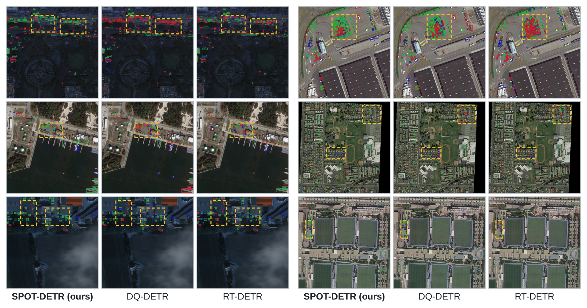
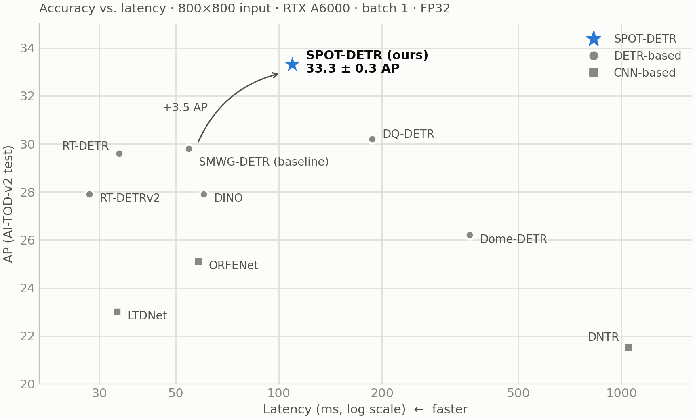
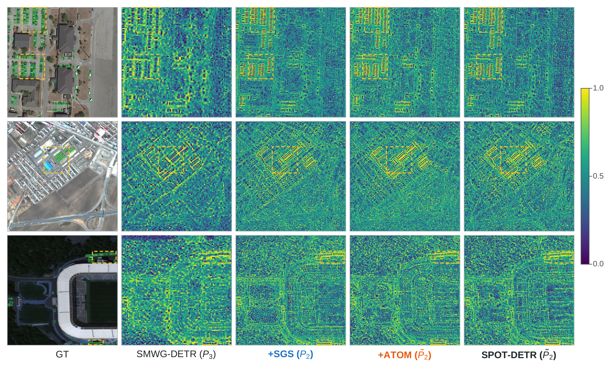

<div align="center">

# SPOT-DETR

### Tiny object detection in aerial images using<br>high-resolution feature refinement and off-grid candidate memory

**Ki-won Eom**<sup>1†</sup> · Cheoneum Park<sup>1†</sup> · Eunkyung Kim<sup>2*</sup> · Haneol Jang<sup>1*</sup>

<sup>1</sup>Department of Computer Engineering, Hanbat National University<br>
<sup>2</sup>Department of Artificial Intelligence Software, Hanbat National University<br>
<sup>†</sup>Equal contribution &nbsp; <sup>*</sup>Corresponding authors &nbsp;·&nbsp; Manuscript in preparation (2026)

[](paper/SPOT_DETR_manuscript_20261022.pdf)
[](#results)
[](#results)

[← Portfolio home](README_EN.md) &nbsp;|&nbsp; [한국어](SPOT-DETR.md) | **English**

</div>


<p align="center"><sub>Existing DETR-based detectors (top) use only features with a stride of 8 or more and start their initial candidates at cell centers. SPOT-DETR (bottom) refines the stride-4 feature X₂ with SGS, adds it to the pyramid, and lets ATOM place atoms that are not tied to cell centers. Red dashed circles mark vehicles the existing detector missed.</sub></p>

Vehicles and people in aerial images are often only a few pixels wide. After the backbone they shrink to one or two cells of a feature map, and an initial candidate that starts at a cell center can miss the IoU 0.5 threshold with a 2-pixel offset. SPOT-DETR handles both problems on a single high-resolution path that starts from the stride-4 backbone feature: SGS refines the feature, and ATOM generates off-grid candidates from it.

- Highest AP among the detectors we retrained under the same protocol, on both AI-TOD (**37.6 AP**) and AI-TOD-v2 (**33.3 AP**).
- AP on very tiny objects (2–8 pixels on a side) rose from 15.7 for the baseline to **20.8**. The smaller the objects, the larger the gain.
- The top 900 initial candidates cover **67.1%** of very tiny objects instead of 38.5%, and their median center error drops from 1.49 to **1.00 pixel**.

This work is linked to Sub-project 5 (*intelligent processing of puzzle-type ultra-wide-area satellite imagery*) of the Space-layer Intelligent Communication Network Specialized Research Lab (KRIT), and I built a [web demo](#web-demo) comparing the two models as my capstone design project.

## Problem

Objects in AI-TOD are 12.8 pixels on average. DETR-based detectors such as DINO and RT-DETR use only features with a stride of 8 or more by default. At stride 8, an object 8 pixels wide or smaller falls into one or two cells and mixes with the responses of its neighbors and the background. The top 900 initial candidates of our baseline covered only 38.5% of these objects with an IoU of 0.5 or higher, against 84.5% for tiny objects.

The position of the candidates was the second problem. Recent DETR-based detectors generate a candidate at every grid cell and use the highest-scoring ones as the decoder's initial queries. Because each candidate starts at a cell center, the offset to the object center has to be corrected by regression alone. A 2-pixel shift in both directions drops the IoU of an 8×8-pixel box to 0.39, and the median center error of the baseline's candidates was still 1.49 pixels after regression.

The two problems are hard to solve separately. A better way of generating candidates does not help if the feature they come from no longer carries the object. We therefore handle the feature and the candidates on the same high-resolution path.

## Method


SPOT (Spatially-gated Path with Off-grid Tokens) is the path that starts from the stride-4 backbone feature X₂ and runs through SGS, multi-scale fusion and ATOM. SPOT-DETR is SMWG-DETR with this path added.

**SGS (Spectral-Guided Selector)** applies a fixed 3×3 Laplacian filter to X₂ to pick up boundaries and local contrast, turns the response into a spatial gate, and multiplies the gate with a local residual. It keeps the resolution and the number of tokens and decides, position by position, how much of the residual to apply. The refined X₂ is fused with the semantic features of the higher stages into P₂.

**ATOM (Adaptive Tiny-Object Off-Grid Memory)** predicts two atoms in every 2×2 block of P₂. Each atom has an occupancy logit, continuous center coordinates inside its block, and a box size. An 800×800 input gives 20,000 atoms from 10,000 blocks. They compete with the grid candidates of P₃–P₅ for the 900 initial queries and reference boxes, and are also written back into P₂ through local rasterization to complement the decoder memory.

The baseline's L1–GIoU regression and matching are unchanged, and inference uses no NMS. Module details and tensor sizes are in the [design notes](docs/design.md) (Korean).

## Results

Every compared detector was trained with its public implementation and default hyperparameters for 40 epochs on the same official train+val split (14,018 images) and evaluated at its last checkpoint on the test split (14,018 images). No numbers were taken from other papers. Evaluation follows the official AI-TOD protocol. SPOT-DETR is reported as mean ± std over three seeds. Training and evaluation ran on one RTX A6000 in FP32.

**AI-TOD-v2 test**

| | Method | AP | AP<sub>vt</sub> | AP<sub>t</sub> | AP<sub>s</sub> |
|---|---|:---:|:---:|:---:|:---:|
| CNN | DNTR | 21.5 | 8.9 | 21.6 | 25.6 |
| | ORFENet | 25.1 | 10.7 | 25.1 | 29.3 |
| | LTDNet | 23.0 | 8.9 | 23.6 | 27.4 |
| DETR | DINO | 27.9 | 15.0 | 28.2 | 32.7 |
| | RT-DETR | 29.6 | 16.1 | 30.2 | 32.9 |
| | RT-DETRv2 | 27.9 | 14.3 | 28.2 | 31.2 |
| | DQ-DETR | 30.2 | 15.6 | 30.4 | 35.7 |
| | Dome-DETR | 26.2 | 11.6 | 25.9 | 31.6 |
| | SMWG-DETR (baseline) | 29.8 | 15.7 | 30.5 | 33.9 |
| | **SPOT-DETR** | **33.3** ± 0.3 | **20.8** ± 0.3 | **34.5** ± 0.7 | **36.1** ± 0.2 |

AP is averaged over IoU thresholds from 0.50 to 0.95. AP<sub>vt</sub>, AP<sub>t</sub> and AP<sub>s</sub> cover objects whose square-root area is 2–8, 8–16 and 16–32 pixels. Over the baseline, AP<sub>vt</sub> rose by 5.1, AP<sub>t</sub> by 4.0 and AP<sub>s</sub> by 2.2 points, so the gain grows as objects get smaller. The seed-to-seed standard deviation (0.2–0.7) is smaller than these gains.

SPOT-DETR beat the baseline in all eight categories, most of all on person (+5.3), vehicle (+5.2) and storage tank (+4.5). DQ-DETR is still higher on airplane, storage tank, swimming pool and wind mill. The per-category numbers are in the [CSV](results/category_aitodv2.csv).

<details>
<summary><b>AI-TOD test</b></summary>

| Method | AP | AP<sub>vt</sub> | AP<sub>t</sub> | AP<sub>s</sub> |
|---|:---:|:---:|:---:|:---:|
| ORFENet | 24.6 | 11.7 | 25.1 | 29.2 |
| LTDNet | 23.5 | 10.6 | 24.8 | 28.3 |
| DQ-DETR | 31.0 | 17.1 | 31.5 | 36.8 |
| SMWG-DETR (baseline) | 32.1 | 17.6 | 33.2 | 37.2 |
| **SPOT-DETR** | **37.6** ± 0.1 | **23.3** ± 0.4 | **39.3** ± 0.2 | **40.4** ± 0.3 |

AI-TOD-v2 re-annotates the same images to fix missing and misplaced boxes. The gain over the baseline (AP +5.5, AP<sub>vt</sub> +5.7) is larger on AI-TOD and holds on both annotation versions.

</details>



<p align="center"><sub>Six AI-TOD-v2 test scenes. Green, blue and red boxes are TP, FP and FN. Yellow dashed boxes mark regions where the models differ most.</sub></p>

In all six scenes SPOT-DETR had the most TPs and the fewest FNs of the three models. In the crowded parking lot (right group, first row) it found 349 of 426 objects, against 322 for DQ-DETR and 219 for RT-DETR. False positives varied by scene: on the dark road (left group, first row) DQ-DETR had 6 FPs and SPOT-DETR had 24. These scenes were picked to show the differences, so overall performance should be read from the tables.



The high-resolution path has a cost. Compute grows from 147.3 to 382.4 GFLOPs and latency from 54.6 to 109.4 ms. SPOT-DETR is faster than the other tiny-object DETRs, DQ-DETR (187.1 ms) and Dome-DETR (360.2 ms), but slower than the real-time RT-DETRv2 (28.0 ms). Latency is the mean over 500 test images on one RTX A6000 with batch size 1 in FP32.

## Analysis

**Components** (AI-TOD-v2, single model trained with seed 42)

| Configuration | AP | AP<sub>vt</sub> | AP<sub>t</sub> | AP<sub>s</sub> |
|---|:---:|:---:|:---:|:---:|
| Baseline | 29.8 | 15.7 | 30.5 | 33.9 |
| + SGS | 33.2 | 20.7 | 34.3 | 36.0 |
| + ATOM | **33.8** | 20.0 | 34.9 | **36.3** |
| + SGS + ATOM (SPOT-DETR) | 33.7 | **21.2** | **35.3** | **36.3** |

Every configuration with SGS or ATOM includes the X₂ path. Adding either one raises AP by 3.4–4.0 points, so most of the gain comes from keeping the spatial cues that downsampling used to erase. Configurations with SGS have a higher AP<sub>vt</sub>, and the combination is best on AP<sub>vt</sub> and AP<sub>t</sub>, which is why it became the final model. On overall AP alone, ATOM by itself is 0.1 points higher.

**Initial candidates** (top 900, AI-TOD-v2 test)

| Candidate source | Very tiny recall | Median center error |
|---|:---:|:---:|
| Baseline · P₃–P₅ grid | 38.5% | 1.49 px |
| + X₂ · P₂–P₅ grid | 62.8% | 1.13 px |
| SPOT-DETR · atoms + P₃–P₅ grid | **67.1%** | **1.00 px** |

Recall is the share of ground truths overlapped by at least one candidate with an IoU of 0.5 or higher. Center error is measured on candidates matched with an IoU of 0.25 or higher. Every very tiny object SPOT-DETR covered came from an atom candidate. Atom centers sat 0.165 cells from the cell center on average, and as the predicted occupancy rose, the share of atoms lying near a real object grew steadily from 2.0% to 48.8%.

<details>
<summary><b>What the feature maps show</b></summary>



In the baseline's P₃, adjacent small objects merge into one response within one or two cells. With the X₂ path, the same objects appear as separate responses. The object-to-background activation contrast, however, was almost the same for SPOT-DETR (2.083) and the baseline (2.082), and the learned SGS gate sat near its upper bound of 2 in both foreground and background. SGS separates neighboring objects at a higher resolution more than it suppresses the background.

</details>

## Limitations


<p align="center"><sub>(a) Scenes with more objects than the 900 queries, (b) a harbor where ships and vehicles mix, (c) oblique drone views. Green, blue and red boxes are TP, FP and FN.</sub></p>

- With a fixed budget of 900 queries, most objects in images with more than 900 objects are missed. Such images are only 0.08% of the test split but hold 3.8% of all objects.
- At a few pixels, ships and vehicles have almost the same shape and brightness, so FPs and FNs appear at the same locations. Context such as water or parking areas is needed.
- Misses increase in oblique drone views, where perspective changes object size within one image. We trained without data augmentation, so augmentation that mimics these size changes may reduce them.
- SPOT-DETR runs at half the speed of the baseline, which is still too slow for real-time use.

## Web demo


Built as my capstone design project. Upload a satellite or aerial image and the demo shows SPOT-DETR and the baseline side by side; large images are tiled into 800×800 crops at native resolution. The score threshold and class filters update the result without rerunning. In the scene above, SPOT-DETR finds 203 vehicles at a 0.5 threshold and the baseline 146. The demo runs on a lab server, so its address is not fixed.

## My role

As co-first author, I worked on every stage from defining the problem to writing the manuscript.

- I traced the baseline's failures to feature resolution and initial-candidate position, and designed the candidate-recall and center-error analyses that test this.
- I implemented the X₂ path, SGS, ATOM, candidate selection and local rasterization on top of the SMWG-DETR code base (MMDetection).
- I retrained and evaluated the nine compared detectors under the same protocol, ran SPOT-DETR with three seeds, and measured the efficiency of all ten models on the same GPU.
- I made the figures and tables and wrote the manuscript.
- I built the web demo that compares the two models, as my capstone design project.

The main lesson was to check why performance improved separately from why I designed a module. SGS was meant to suppress background responses, but the analysis showed an almost uniform gate and a gain that came from resolution. I rewrote the explanation in the manuscript to match what we observed. The process is recorded in the [development notes](docs/development.md) (Korean).

Next, I plan to spend high-resolution computation only on foreground regions to cut the cost, adapt the number of queries to object density for crowded scenes, and test the method on other sensors and imaging conditions.

## Materials

| | |
|---|---|
| [Manuscript PDF](paper/SPOT_DETR_manuscript_20261022.pdf) | Version of 22 October 2026, not yet submitted |
| [Design](docs/design.md) | Data flow, modules, tensor sizes (Korean) |
| [Experiments](docs/experiments.md) | Per-category results, candidate analysis, efficiency setup (Korean) |
| [Development notes](docs/development.md) | How the problem was narrowed and the interpretation revised (Korean) |
| [Implementation](docs/implementation.md) | Training settings and what a full reproduction needs (Korean) |
| [Result CSVs](results/README.md) | Manuscript Tables 1–6 |

Training and inference code and checkpoints are not included because the paper has not been submitted yet. The numbers in the tables can be recomputed from the CSVs.

```bash
python3 scripts/summarize_results.py   # gains over the baseline, efficiency ratios
python3 scripts/plot_results.py        # AP–latency chart (needs matplotlib)
```

## Acknowledgements

The implementation builds on [SMWG-DETR](docs/references.md) and [MMDetection](https://github.com/open-mmlab/mmdetection), and uses the [AI-TOD](https://github.com/jwwangchn/AI-TOD) and [AI-TOD-v2](https://chasel-tsui.github.io/AI-TOD-v2/) datasets.
