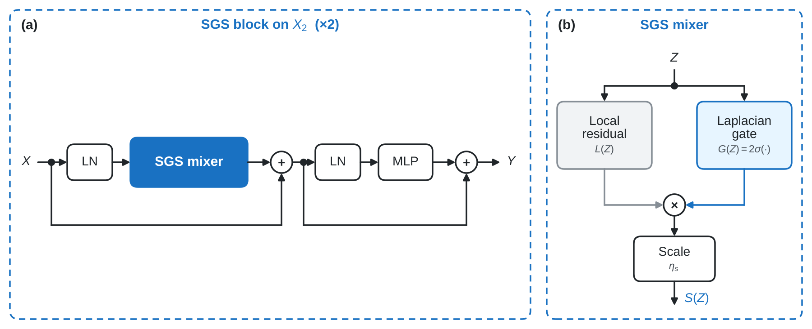
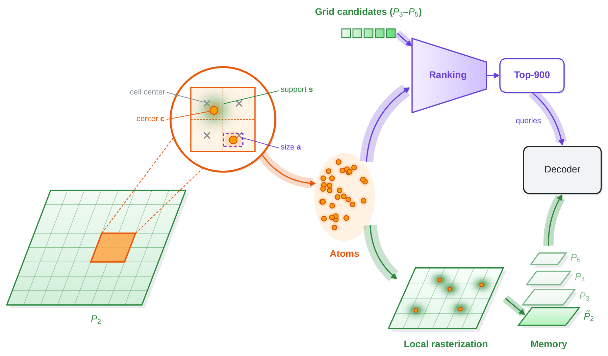

# SPOT-DETR 설계 상세

[SPOT-DETR 프로젝트 페이지](../SPOT-DETR.md) · [홈](../README.md) · 근거: 투고 전 원고 1절·3절, 그림 1–4.

## 문제와 설계의 연결

극소 객체 탐지에서 특징의 공간 단서와 초기 후보의 위치는 연결되어 있습니다. 초기 위치만 바꾸더라도 그 위치를 예측하는 특징에 객체 정보가 남아 있지 않으면 효과가 제한됩니다. SPOT-DETR은 stride 4 경로를 통해 이 두 문제를 함께 다룹니다.

기준 모델은 SMWG-DETR입니다. 스펙트럼 변조, 웨이블릿 유도 융합, 잡음 제거 학습은 기반 모델의 설계를 따릅니다. 연구에서 새로 설계한 부분은 **SGS와 ATOM**, 그리고 이들을 연결하는 고해상도 경로입니다. 융합은 X₂를 포함하도록 확장했습니다.

## 전체 데이터 흐름

```text
800×800 입력
  └─ ResNet-50
      ├─ X₂ / stride 4  → SGS ×2 ─────────┐
      ├─ X₃ / stride 8  → 스펙트럼 변조 ─┤
      ├─ X₄ / stride 16 → 스펙트럼 변조 ─┤→ 다중 스케일 융합 → P₂–P₅
      └─ X₅ / stride 32 → 스펙트럼 변조 ─┘                    │
                                                    P₂ → ATOM
                                                          ├─ atom 후보
                                                          └─ 국소 래스터 잔차 → 보완된 P₂
  atom 후보 + P₃–P₅ 격자 후보 → 상위 900개 → 초기 쿼리·참조 상자
  보완된 P₂ + P₃–P₅ → 디코더 메모리 → 6층 디코더 → 범주·상자
```


| 특징 | stride | 800×800 입력의 공간 크기 | 채널 |
|---|---:|---:|---:|
| X₂ / P₂ | 4 | 200×200 | 256 |
| X₃ / P₃ | 8 | 100×100 | 256 |
| X₄ / P₄ | 16 | 50×50 | 256 |
| X₅ / P₅ | 32 | 25×25 | 256 |

위 X₂–X₅는 백본의 각 단계 출력을 1×1 합성곱과 배치 정규화로 **256채널에 투영한 특징**입니다. 백본의 원시 출력 채널 수와 구분합니다.

총 디코더 메모리는 40,000 + 10,000 + 2,500 + 625 = **53,125개 토큰**입니다. 고해상도 경로가 늘리는 정보량과 계산량을 함께 고려해야 합니다.

## SGS — 국소 잔차를 조절하는 공간 게이트

SGS(Spectral-Guided Selector)는 정규화된 X₂에서 고정 라플라시안 필터의 응답을 계산하고, 채널 평균 절댓값으로 공간 단서를 얻습니다. 이를 작은 합성곱 네트워크에 넣어 게이트를 생성하고, 국소 변환으로 만든 잔차에 곱합니다.



| 구성 | 설정 |
|---|---|
| 적용 위치 | 융합 전 X₂에 SGS 블록 2개 |
| 국소 변환 | 256 → 64채널 축소, depthwise·pointwise 합성곱, 256채널 복원 |
| 공간 단서 | 3×3 고정 라플라시안 응답의 채널 평균 절댓값 |
| 게이트 | 16채널 3×3 합성곱 → SiLU → 1×1 합성곱 → 2×sigmoid |
| 초기값 | 게이트 1, 학습 가능한 잔차 계수 0.1 |
| 유지되는 것 | 공간 크기·토큰 수 |

여기서 spectral은 라플라시안의 고역 통과 특성에 대응합니다. 최종 X₂의 SGS를 FFT 채널 게이트로 설명하지 않습니다. 상위 특징에 적용하는 기존 스펙트럼 변조와도 구분합니다.

**관찰된 동작:** 학습된 공간 게이트가 전경·배경 모두에서 2에 가까웠습니다. 따라서 설계가 위치별 조절을 허용한다는 사실과, 학습 후 실제로 강한 배경 억제가 관찰되었다는 주장은 구분해야 합니다. 본 연구의 분석은 고해상도에서의 응답 분리를 더 직접적으로 뒷받침합니다.

## ATOM — 연속 좌표 후보와 국소 메모리 보완

ATOM(Adaptive Tiny-Object Off-Grid Memory)은 융합된 P₂에서 작동합니다. P₂를 64채널로 줄이고, 겹치지 않는 2×2 블록마다 두 개의 atom을 예측합니다.



각 atom은 객체 존재 로짓, 블록 안의 연속 중심 좌표, 상자 크기, 래스터 확산 범위, atom 특징으로 구성됩니다. **off-grid는 중심이 격자 셀 중심에 고정되지 않는다는 뜻**입니다.

atom은 두 경로에서 사용됩니다.

1. **초기 후보:** P₃–P₅의 격자 후보와 합쳐 상위 900개를 선택하고, 디코더의 초기 쿼리와 참조 상자를 만듭니다.
2. **메모리 보완:** atom당 최대 3×3 이웃에 국소적으로 기록한 래스터 잔차를 P₂에 더합니다. 겹치는 기여는 정규화합니다.

보조 감독은 atom이 작은 객체를 표현하도록 학습을 돕습니다. 후보 순위 점수에는 최대 클래스 로짓과 객체 존재 로짓의 가중합을 사용하며, 최종 가중치는 0.25입니다. 기준 모델의 L₁–GIoU 상자 회귀·매칭 방식을 유지한 것이 최종 원고의 설정입니다.

## 설계 선택을 검증한 근거

| 질문 | 확인한 결과 | 해석 범위 |
|---|---|---|
| 고해상도 후보가 필요한가? | very tiny 재현율 38.5% → X₂ 추가 62.8% | 해상도 확장이 큰 공통 기반 |
| 연속 위치가 실제 사용되는가? | atom 중심의 평균 격자 이탈 0.165셀 | 중심이 셀 중심에 고정되어 있지 않음 |
| 초기 위치 오차가 줄었는가? | 대응 후보 중심 오차 중앙값 1.49 → 1.00픽셀 | 해상도와 최종 구성이 함께 변한 비교 |
| 래스터 잔차가 특징을 크게 바꾸는가? | 객체 셀 0.47%, 배경 셀 0.18% | 특징을 대체하는 효과보다 작은 보완 |

결과는 개선 원인을 뒷받침하지만, 모든 효과를 off-grid 중심 하나로 설명하지는 않습니다. [정량 분석의 전체 조건 →](experiments.md)
